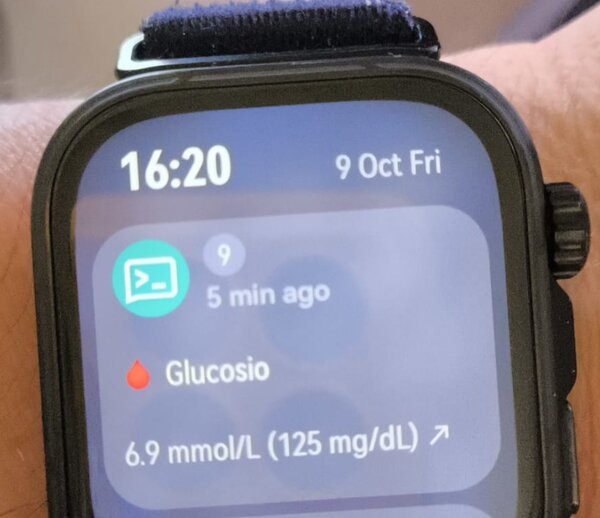
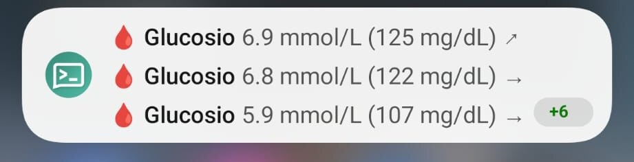

# glucose-watch-bridge

**Self-hosted pipeline that brings FreeStyle Libre 2 CGM readings to any smartwatch that mirrors Android notifications, with no third-party cloud services other than the sensor vendor's own.**

<p align="center">
  
</p>
<p align="center">
  
</p>

> ⚠️ **Not a medical device.** This is an unofficial, personal open-source project. It is **not affiliated with, endorsed by or supported by** Abbott, Huawei, Google, Xiaomi, the Nightscout Foundation or any other brand mentioned here. Do **not** use it to make treatment decisions. Read the full [DISCLAIMER](DISCLAIMER.md).

---

## Why this exists

Many smartwatches (for example the Huawei Watch Fit line) can't run third-party CGM apps and have no native integration with the FreeStyle Libre ecosystem. They **can** mirror the notifications of the paired Android phone, though.

This project turns that limitation into the delivery channel:

1. Glucose readings are polled every 5 minutes from **LibreLinkUp**, the follower service of FreeStyle Libre.
2. Each reading is stored in a self-hosted **Nightscout** instance, which gives you history, charts and a dashboard.
3. A push notification is sent through a self-hosted **ntfy** server to the phone.
4. The phone mirrors the notification to the **watch**: a glance at your wrist shows the current value and trend.

Everything except LibreLinkUp itself runs on your own hardware (a NAS, a Raspberry Pi, a small VM…).

## What it does

| Feature | Details |
|---|---|
| Polling | LibreLinkUp is polled every 5 minutes by an **n8n** workflow |
| Storage | Every reading is written to **Nightscout** (`/api/v1/entries`), so the history and charts are yours |
| Routine updates | A **silent** notification every 15 minutes with the value and trend, e.g. `6.9 mmol/L (125 mg/dL) ↗` |
| Alerts | **Urgent** notifications (they vibrate the watch) as soon as a reading is out of range. The thresholds are configurable, see [thresholds](docs/thresholds.md) |
| Self-monitoring | A second workflow sends **"⚠️ Glucose pipeline DOWN"** if the pipeline fails, at most once per hour, with the reason (e.g. *new terms of use must be accepted*) |
| Privacy | ntfy runs with `deny-all`: nobody can read or publish to your topic without an account |
| Optional | **xDrip+** in *Nightscout Follower* mode for charts on the phone |

## Architecture

```
FreeStyle Libre 2 sensor ──► LibreLink app (patient phone) ──► LibreLinkUp cloud (Abbott)
                                                                     │
                                                                     │ HTTPS poll every 5 min
                                                                     ▼
                                                        ┌──────────── n8n ────────────┐
                                                        │ login → connections →        │
                                                        │ transform → thresholds       │
                                                        └──────┬───────────────┬──────┘
                                                               │               │
                                              POST /api/v1/entries      POST /<topic>
                                                               ▼               ▼
                                                  Nightscout + MongoDB       ntfy
                                                  (history, dashboard)   (push, deny-all)
                                                               │               │
                                                  (optional) xDrip+      ntfy Android app
                                                               └──────┬────────┘
                                                                      ▼
                                                          Android phone notifications
                                                                      │ notification mirroring
                                                                      ▼
                                                                 Smartwatch
```

## How it was designed

- **Self-hosted first.** The only external dependency is the vendor's own follower API. There are no third-party relays, no bridge SaaS and no extra accounts.
- **Use what the watch already does well.** Instead of writing a watch app, which many platforms don't allow, the project relies on the notification mirroring every companion app already provides.
- **Small, replaceable blocks.** n8n handles the logic, Nightscout the storage, ntfy the delivery. Each one can be swapped or reused for other purposes.
- **Fail loudly.** The vendor API is unofficial and occasionally changes (new terms of use, region redirects). An error workflow tells you when data stops flowing, so you don't find out hours later.

## Repository layout

```
README.md                         ← this file
DISCLAIMER.md                     ← medical / trademark / API disclaimer
docs/requirements.md              ← hardware, software and accounts you need
docs/setup.md                     ← step-by-step installation guide
docs/thresholds.md                ← how alert thresholds work and how to change them
docker/nightscout/                ← docker-compose.yml + .env.example
docker/ntfy/                      ← docker-compose.yml + config/server.yml.example
n8n/glucose-watch-bridge.json              ← main workflow
n8n/glucose-watch-bridge-error-alert.json  ← error workflow (pipeline-down alert)
```

## Quick start

1. Check the [requirements](docs/requirements.md).
2. Deploy **Nightscout** and **ntfy** with the compose files in `docker/`.
3. Import both workflows into **n8n**, create the 3 credentials and replace the `<PLACEHOLDERS>`.
4. Install the **ntfy** app on the phone, subscribe to your topic and enable notification mirroring for it in the watch companion app.
5. Adjust the [alert thresholds](docs/thresholds.md).

The full walkthrough is in **[docs/setup.md](docs/setup.md)**.

## Lessons learned (gotchas)

| Problem | Cause / fix |
|---|---|
| `status: 920` on login | LibreLinkUp requires a minimum app `version` header. `4.16.0` works |
| `400 RequiredHeaderMissing` | The `account-id` header (SHA256 of your `user.id`) is mandatory |
| `/llu/connections` returns no data | Use a **follower** account (invited from the patient's LibreLink app), not the patient account |
| Login returns `{"redirect": true, "region": "eu"}` | Call the regional endpoint directly (`api-eu.libreview.io`, `api-us.…` etc.) |
| Login returns `status: 4`, step `tou`, then `401 invalid or expired jwt` | Abbott periodically asks to **re-accept the terms of use**: open the LibreLinkUp app and accept. The error workflow will tell you |
| `Module 'crypto' is disallowed` in n8n | The n8n task-runner sandbox blocks `crypto`, so the `account-id` hash is precomputed once |
| ntfy receives a JSON blob instead of text | In the n8n HTTP Request node use `contentType: raw` + `text/plain`, not "string" body |
| Nightscout won't start behind a reverse proxy | `INSECURE_USE_HTTP=true` (exactly the string `"true"`) when `BASE_URL` is https but the container serves http |
| MongoDB crashes with "Illegal instruction" | Your CPU lacks AVX (MongoDB 5.0+) or ARMv8.2 (4.4.19+). See the tags in the compose file |
| Notifications stop when the phone is idle | Disable battery optimization for the ntfy app (and xDrip+), and allow autostart on MIUI/HyperOS |

## License

[MIT](LICENSE) © manumaiden

Third-party projects used here keep their own licenses: [Nightscout](https://github.com/nightscout/cgm-remote-monitor) (AGPL-3.0), [ntfy](https://github.com/binwiederhier/ntfy) (Apache-2.0 / GPL-2.0), [n8n](https://github.com/n8n-io/n8n) (Sustainable Use License), [xDrip+](https://github.com/NightscoutFoundation/xDrip) (GPL-3.0).
